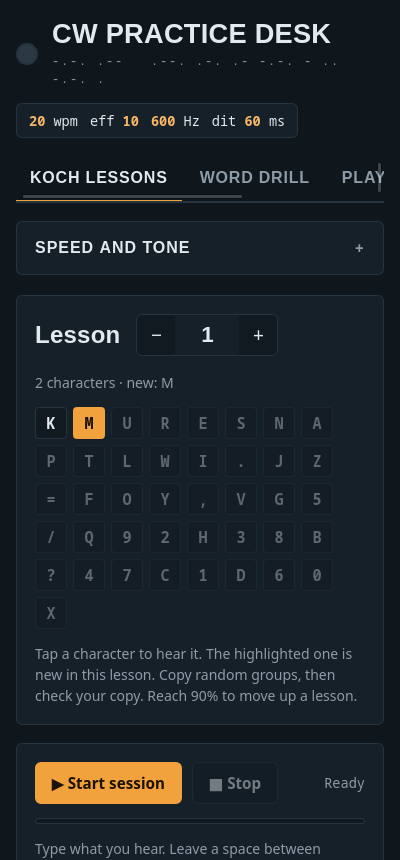
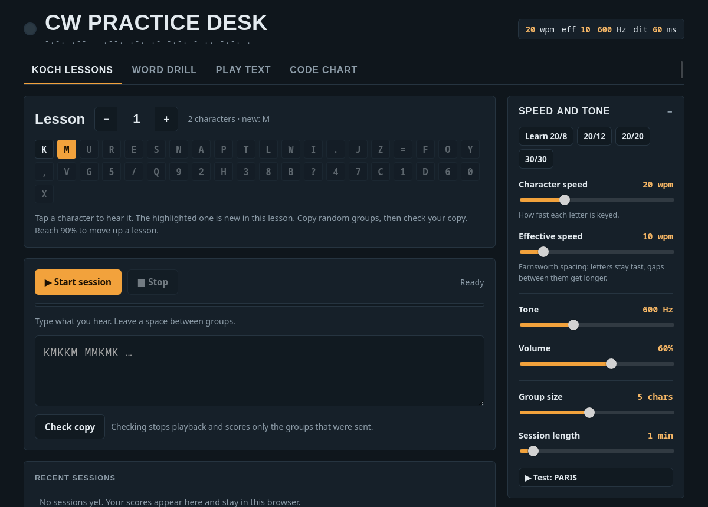

# CW Practice Desk

A free Morse code (CW) trainer for Android and Linux, inspired by [LCWO](https://lcwo.net). It needs no account and no internet connection. The Android app is about 35 KB.

<p>
  
  
</p>

## Download

**Android:** [CWPracticeDesk.apk](https://github.com/davidsteenvoorden/cw-practice-desk/releases/latest/download/CWPracticeDesk.apk) (Android 8.0 or newer)

All versions are on the [Releases page](https://github.com/davidsteenvoorden/cw-practice-desk/releases).

## What it does

- **Koch lessons.** Uses the same 40-lesson character order as LCWO, starting with K and M. The app plays random groups of characters and you type what you hear. When you check your copy, it scores you and marks each mistake. At 90% or better it offers the next lesson.
- **Word drill.** Practise common English words, random callsigns (W1ABC, DL3XY, S52AB…), ham abbreviations (CQ, QTH, RST, 73…) or single characters from your current lesson. You can turn on adaptive speed: each correct answer adds 1 wpm and each miss takes 1 away.
- **Play text.** Type or paste any text and the app keys it, highlighting each character as it plays.
- **Code chart.** Tap any letter, number or prosign to hear it.

### Speed and tone settings

| Setting | Range | What it does |
|---|---|---|
| Character speed | 5–60 wpm | How fast each character is keyed |
| Effective speed | 3–60 wpm | Farnsworth spacing: characters stay at full speed and the gaps between them get longer. 20/8 is a good place to start |
| Tone | 300–1200 Hz | Pitch of the sidetone |
| Volume | 0–100% | |
| Group size | 1–10 | Characters per group in Koch lessons |
| Session length | 0.5–10 min | How long a Koch session runs |

Timing follows the PARIS standard: one dit lasts 1.2 / wpm seconds. Farnsworth gaps use the ARRL formula. Each tone fades in and out over 5 ms, so there are no key clicks.

Your settings, current lesson and recent scores are saved on the device. Nothing is ever sent anywhere, and the app requests no permissions.

## Installing on Android

1. On your phone, download `CWPracticeDesk.apk` from the link above.
2. Open the file. If Android blocks it, allow your browser or file manager to **install unknown apps** when it asks.
3. Google Play Protect may warn that it doesn't recognise the app, because it isn't on the Play Store. Tap **More details → Install anyway**.

To update, install the newer APK over the old one. Your progress is kept.

Or install from a computer over USB:

```bash
adb install -r CWPracticeDesk.apk
```

## Running on Linux

The desktop version is a small Python window around the same page. It needs GTK 3, WebKit2GTK 4.1 and PyGObject. Most desktops already have them.

| Distro | Packages |
|---|---|
| Arch | `pacman -S webkit2gtk-4.1 python-gobject` |
| Debian/Ubuntu | `apt install gir1.2-webkit2-4.1 python3-gi` |
| Fedora | `dnf install webkit2gtk4.1 python3-gobject` |

```bash
git clone https://github.com/davidsteenvoorden/cw-practice-desk.git
cd cw-practice-desk
python3 desktop/cw-practice-desk.py
```

To add it to your app menu:

```bash
./desktop/install.sh
```

Settings are saved in `~/.local/share/cw-practice-desk`.

You can also open `web/index.html` straight in any modern browser (Windows and macOS included). Everything works there too, but progress is tied to that browser.

## Project layout

```
web/index.html        The whole app: HTML, CSS and JavaScript in one file
desktop/              GTK/WebKit wrapper for Linux, launcher and icon
android/              Android wrapper: one Activity with a WebView, no libraries
build-apk.sh          Builds the APK into ./CWPracticeDesk.apk
```

Both wrappers load the same `web/index.html`. To change the app, edit that file.

## Building the APK

You need the Android SDK (platform 37) and JDK 17 or newer. The JDK bundled with Android Studio works.

```bash
cd android
echo "sdk.dir=$HOME/Android/Sdk" > local.properties
JAVA_HOME=/opt/android-studio/jbr ./gradlew :app:assembleRelease
```

The APK is written to `android/app/build/outputs/apk/release/`. If there is no `android/keystore.properties`, the build is signed with your debug key, which is fine for personal use. Official releases are signed with the project's release key.

## Troubleshooting

- **No sound on Android:** check the media volume, not the ringer volume.
- **Linux window crashes with `Error 71 (Protocol error)`:** this happens with NVIDIA on Wayland. The launcher already sets `WEBKIT_DISABLE_DMABUF_RENDERER=1`. If you start the page some other way, set that variable yourself.
- **"App not installed" when updating:** the APK you have was signed with a different key (for example, one you built yourself). Uninstall the old app first.

## License

MIT. See [LICENSE](LICENSE).
